# Explorer | Vulnyx Writeup

## Description

Explorer is an easy VulNyx machine that demonstrates the risks of default credentials, insecure file-management applications, arbitrary PHP file creation, and plaintext credential storage.

## Reconnaissance

- We start by performing a scan with Nmap.

`nmap -sCVS -p- -D RND:10 -T4 192.168.1.56`

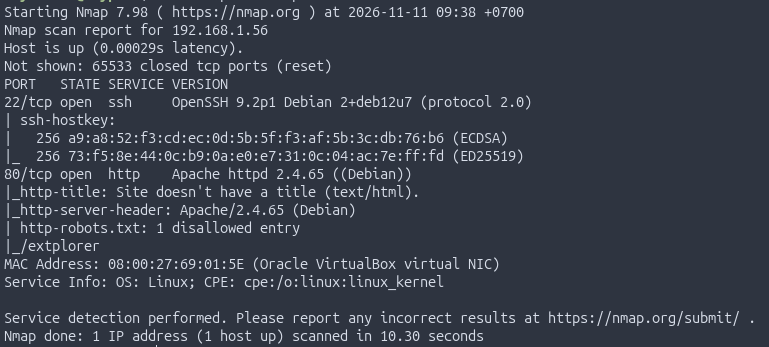

## Web Enumeration

- From the scan, we can see that the server has ports `22` and `80` open, which correspond to SSH and HTTP.
- Open the website in a browser.

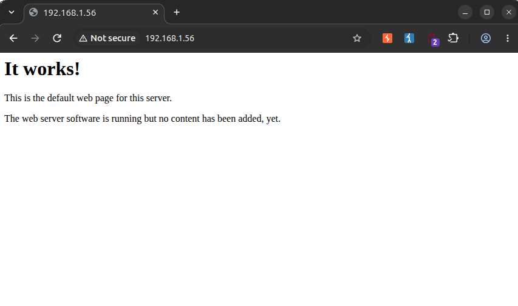

--------------------------------

- We can see that `robots.txt` contains a path to `/extplorer`.

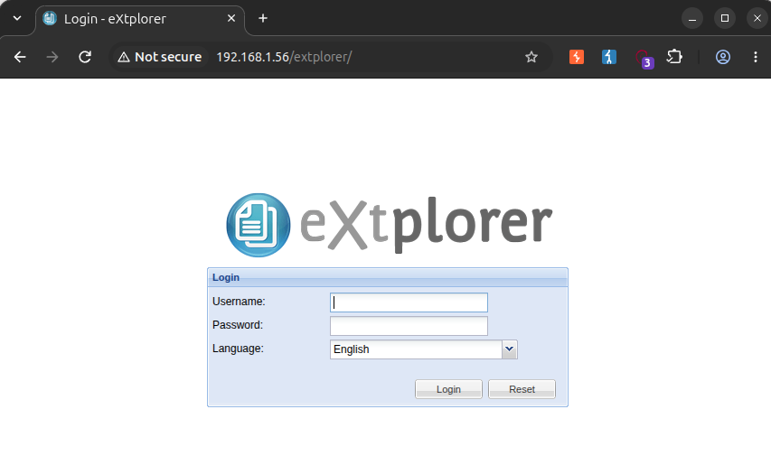

---------------------------------

## eXtplorer Authentication

- Try to access eXtplorer using the default credentials:
`admin - admin `

- We can access eXtplorer using the default credentials.

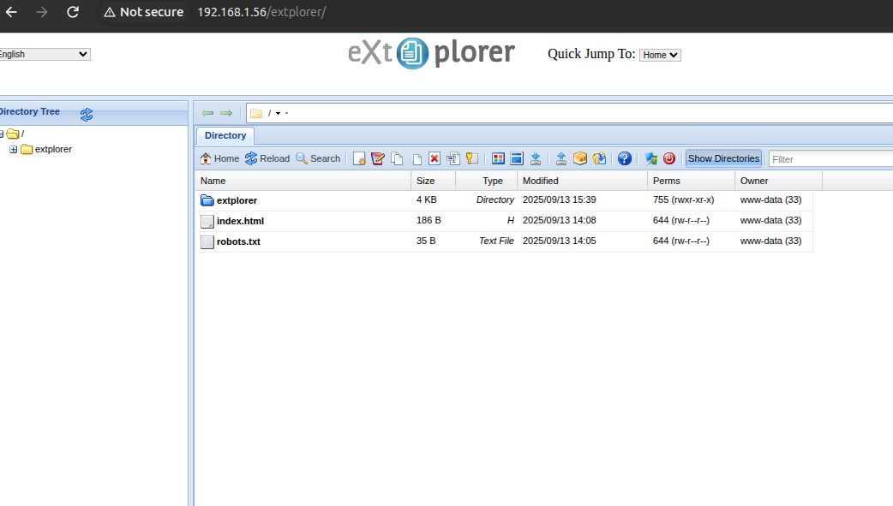

## Web Shell Upload

- The eXtplorer folder shows that this server uses PHP. Let's upload a PHP shell.

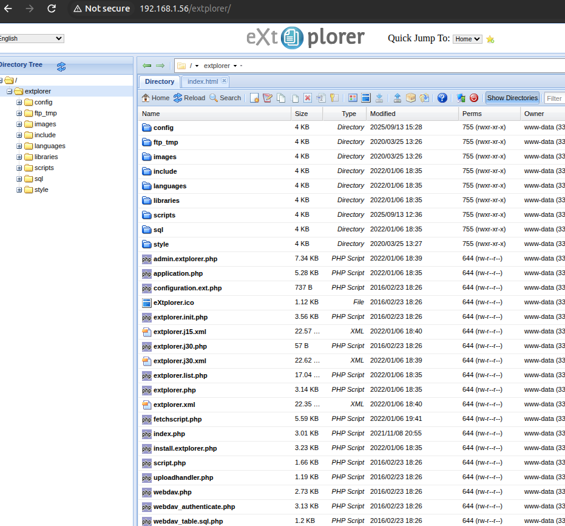

- First, try uploading a PHP info file with the following content:

   ` <?php phpinfo(); ?> `

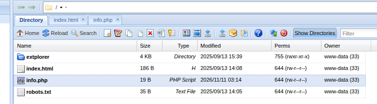
-------------------------------------
- Open that file in a web browser.

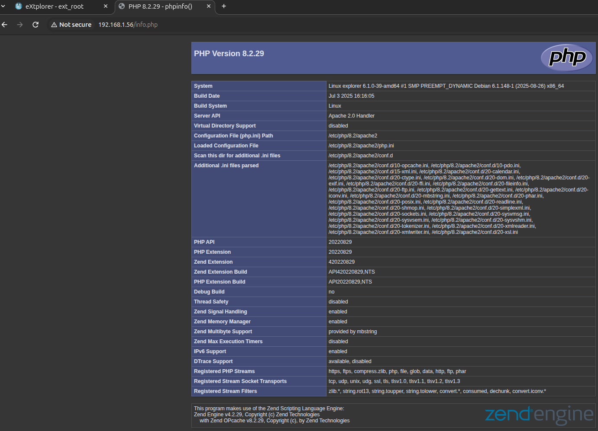

- We can execute PHP code, so now we can upload a PHP shell to the server. I will use `p0wny-shell`, which can be used to quickly execute commands on a server while penetration testing a PHP application.

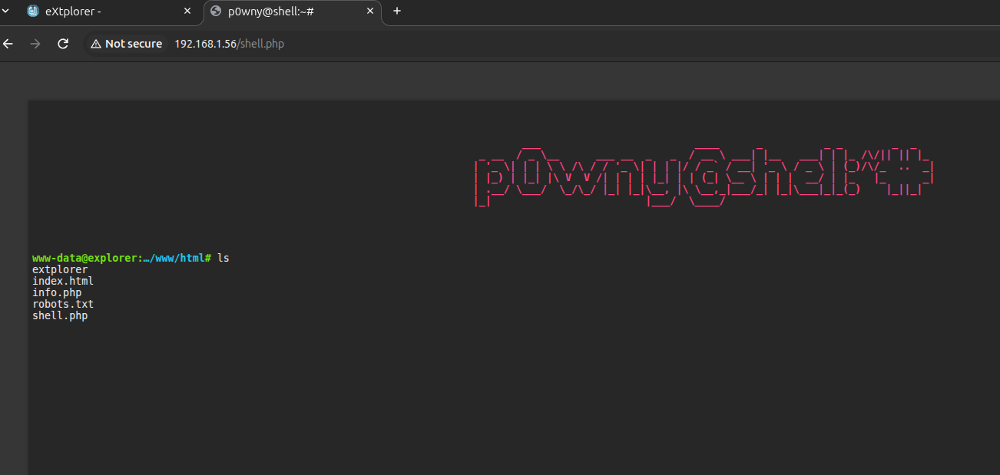

- Now, we can navigate the server's files. Alternatively, you can browse them through eXtplorer; in fact, we are already logged in as the admin.

## 🔍 Credential Enumeration
- Open the `config` folder in eXtplorer, then open the `conf.php` file.

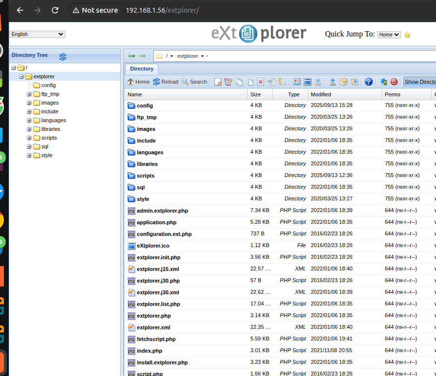
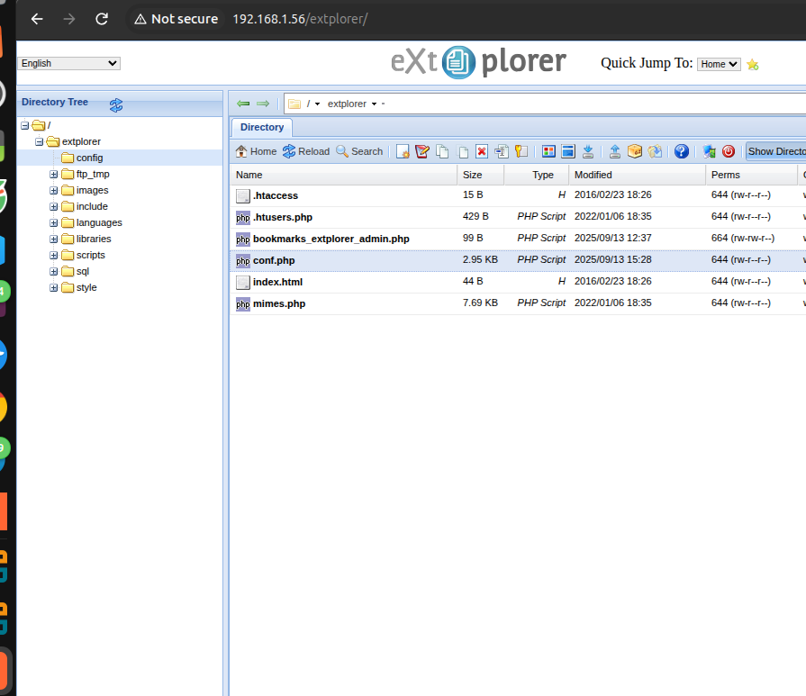

- We find the following credentials:

` $GLOBALS['DB_HOST'] = 'localhost';
$GLOBALS['DB_NAME'] = 'webdav';
$GLOBALS['DB_USER'] = 'root';
$GLOBALS['DB_PASSWORD'] = 'AccessGranted#1';
$GLOBALS['DB_TYPE'] = 'mysql'; // Name of the Database Server Type
`

## ⬆️ Privilege Escalation

- Let's try to switch to the root user.
- Since the server has SSH open, we can try connecting to it with SSH:
 ` ssh root@192.168.1.56 `
using these credentials:
`
$GLOBALS['DB_USER'] = 'root';
$GLOBALS['DB_PASSWORD'] = 'AccessGranted#1';
`
- The connection succeeds.

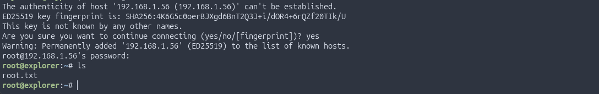

## Flags

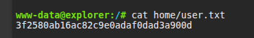
- User flag: 3f2580ab16ac82c9e0adaf0dad3a900d

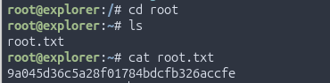
- Root flag: 9a045d36c5a28f01784bdcfb326accfe